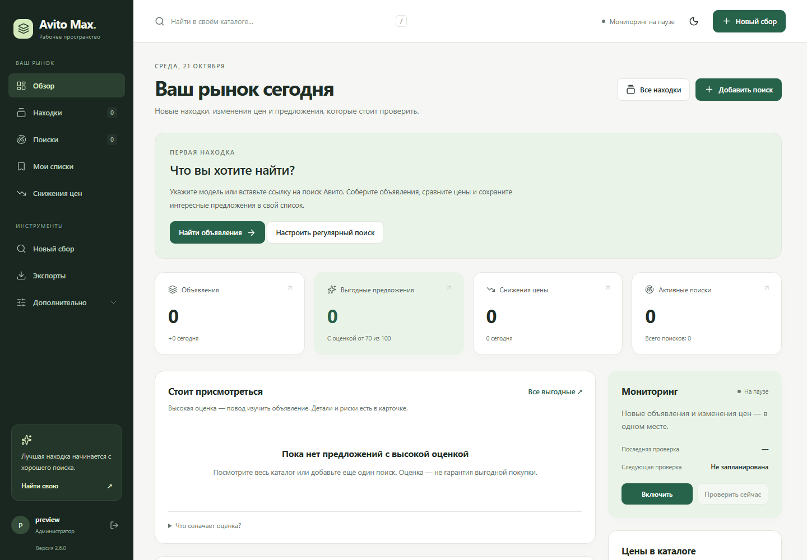
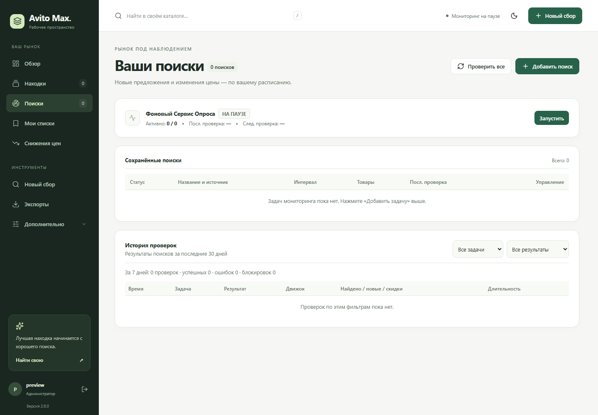

# Avito Max Parser

Avito Max Parser собирает объявления Авито, проверяет сохранённые поиски по расписанию и показывает, когда меняется цена. Веб-панель, консоль и Telegram-бот работают с одной локальной базой SQLite. Можно начать с одного запроса в браузере: бот, прокси и языковая модель для этого не нужны.



Скриншоты сделаны на версии 2.6.0 с отдельной тестовой базой, без рабочих объявлений и внешнего сбора.

- [Установка и первый вход](#установка-и-первый-вход)
- [Первый сбор](#первый-сбор)
- [Постоянные поиски и уведомления о цене](#постоянные-поиски-и-уведомления-о-цене)
- [Каталог, оценки и экспорт](#каталог-оценки-и-экспорт)
- [Telegram, языковая модель и webhook](#telegram-языковая-модель-и-webhook)
- [Настройки и права](#настройки-и-права)
- [Резервные копии и обновление](#резервные-копии-и-обновление)
- [Если что-то не работает](#если-что-то-не-работает)
- [Консоль и разработка](#консоль-и-разработка)

## Установка и первый вход

Для установки из исходников нужны Git и Python 3.10 или новее; для браузерного сбора — Chromium от Playwright. Если у вас уже распакован архив проекта, начните с команд установки зависимостей в его папке. Устанавливайте и запускайте панель под своей учётной записью.

### Windows

Команды для PowerShell:

```powershell
git clone https://github.com/domovoyproj/avito-parser.git
Set-Location avito-parser
.\install_windows.bat
.\.venv\Scripts\python.exe setup_admin.py
.\start_panel.bat
```

Установщик создаёт `.venv`, устанавливает зависимости и Chromium. Если вы используете старое окружение `venv`, замените `.venv` в командах на `venv`. Проверьте созданный `.env`: для локальной работы задайте `WEB_HOST=127.0.0.1` и оставьте `TELEGRAM_BOT_TOKEN` пустым, пока не подключите своего бота.

### Linux

Команды для Ubuntu/Debian:

```sh
git clone https://github.com/domovoyproj/avito-parser.git
cd avito-parser
python3 -m venv .venv
. .venv/bin/activate
python -m pip install -r requirements.txt -c constraints.txt
python -m playwright install --with-deps chromium
python setup_admin.py
python web_server.py
```

Для создания окружения может потребоваться пакет `python3-venv`, а для установки системных библиотек Chromium — права `sudo`. Если библиотеки уже есть, достаточно `python -m playwright install chromium`. В репозитории также есть `install_ubuntu.sh` и `setup_systemd.sh`. Если используете их для запуска при загрузке сервера, учтите, что они рассчитаны на окружение `venv`, а скрипт systemd включает и веб-панель, и Telegram-бота.

### Docker Compose

Нужны Docker и Compose v2. Ниже пример для Linux-хоста; команды запускаются из папки проекта.

```sh
mkdir -p data exports logs config
# Для новой установки; при обновлении сохраните свой config/.env.
test -e config/.env || install -m 0600 .env.example config/.env
sudo chown -R 10001:10001 data exports logs config
docker compose build web
docker compose run --rm --no-deps web python setup_admin.py
docker compose up -d web
docker compose ps
curl -fsS http://127.0.0.1:8000/ready
```

Compose читает `config/.env` внутри контейнера и сохраняет данные в смонтированных каталогах. По умолчанию порт `8000` опубликован на всех интерфейсах хоста. Для локальной панели или reverse proxy на том же хосте замените `"8000:8000"` в [docker-compose.yml](docker-compose.yml) на `"127.0.0.1:8000:8000"` **до запуска**. Для бота сначала укажите свои настройки в `config/.env`, затем выполните `docker compose up -d --build bot`.

### Вход

Откройте [http://127.0.0.1:8000](http://127.0.0.1:8000) на машине, где запущена панель. При первом запуске `setup_admin.py` попросит имя, пароль от 12 символов и его подтверждение. Войдите с этим паролем. Даже если старый установщик выводит подсказку про пароль по умолчанию, она не действует.

Для доступа с другой машины разместите панель за HTTPS reverse proxy или в закрытой сети. Для HTTPS включите `WEB_SECURE_COOKIES=true` и перезапустите панель. [nginx_avito.conf](nginx_avito.conf) — пример проксирования на порт 8000; TLS настраивается отдельно.

## Первый сбор

1. Откройте **Новый сбор** и введите, например, `Samsung Galaxy S25`. Название ищется по всей России. Для конкретного города, категории или фильтров сначала настройте их на Авито и вставьте ссылку на **поисковую выдачу**.
2. Для первой проверки выберите одну страницу, оставьте браузерный способ сбора и включите сохранение в каталог.
3. Нажмите **Начать сбор**. Панель показывает число обработанных страниц, найденных и сохранённых объявлений. Можно перейти в другой раздел: задача выполняется на сервере.
4. Откройте **Находки**. При остановке, тайм-ауте или ошибке уже записанные страницы остаются в каталоге. Если выключить сохранение, результаты доступны только в текущей задаче; перезапуск сервера очищает историю разовых задач из памяти.

Для одной конкретной карточки откройте **Дополнительно → Проверить объявление** и вставьте прямую ссылку. Этот режим извлекает подробности объявления: описание, фотографии и характеристики, если они есть в карточке.

Если Авито просит подтвердить доступ, посмотрите уведомление задачи. Ручная проверка возможна только в видимом Chromium **на машине, где запущена панель**, с доступным рабочим столом. В обычном контейнере без графической среды окно не появится. Приложение не решает капчу автоматически; при повторной блокировке остановите сбор и проверьте доступ обычным способом.

## Постоянные поиски и уведомления о цене

1. Настройте поиск на Авито и скопируйте ссылку на выдачу. В панели откройте **Поиски → Добавить поиск**.
2. Задайте название, при необходимости границы цены и интервал проверки. Оставьте задачу активной. Из «Нового сбора» тот же поиск можно сохранить кнопкой **Следить постоянно**.
3. Нажмите **Проверить сейчас** в строке задачи и посмотрите **Историю проверок**. После первой проверки включите фоновый мониторинг, если он выключен. **Проверить все** запускает проверку активных поисков вручную.
4. Оставьте процесс панели или бота запущенным. Интервал в задаче задаёт, как часто её можно проверять. Общий интервал цикла в настройках определяет, как часто сервис просматривает очередь; переключатель мониторинга не запускает все задачи немедленно. Расписание ориентируется на часовой пояс процесса сервера.



«Пусто» означает, что проверка завершилась без находок. «Частично» означает, что получена только часть результата. «Заблокировано», «Ошибка» и «Пропущено» отмечаются отдельно. При блокировках фоновые задачи получают паузы 5, 15 и 60 минут.

Чтобы следить за конкретным объявлением, добавьте его из каталога в список, откройте **Мои списки** и задайте целевую цену через **Изменить**. Держите исходный поиск активным: уведомление создаётся, когда очередная проверка зафиксирует снижение до цели. Сам список не запускает отдельный обход карточек. Для личного сообщения привяжите Telegram, как описано ниже.

## Каталог, оценки и экспорт

| Раздел | Что можно сделать |
| --- | --- |
| **Обзор** | Посмотреть состояние мониторинга, находки и изменения цен. |
| **Находки** | Искать по сохранённому каталогу, отбирать объявления по поиску, цене и другим фильтрам, переключаться между карточками и таблицей. |
| **Снижения цен** | Увидеть зафиксированные изменения и перейти к объявлению. |
| **Мои списки** | Собирать личные подборки, оставлять заметки, задавать целевую цену и ставить оповещения на паузу. |
| **Качество оценок** | Посмотреть сводку ручных меток, которые оставляют в карточках. |

Поиск в каталоге работает по началам слов в сохранённых данных. Если по части слова ничего не найдено, попробуйте начало слова или сбросьте фильтры.

**Deal Score** — оценка по правилам: сравнение цены, доступные данные о продавце и признаки риска. В карточке можно посмотреть причины оценки, а администратор может добавить свои правила в **Настройки → Правила**. В калькуляторе перепродажи укажите цену покупки, предполагаемую цену продажи и расходы. Результат показывает разницу по введённым значениям; цену будущей продажи и состояние товара нужно проверить самостоятельно.

Для выгрузки откройте **Находки**, примените нужные фильтры и выберите **Excel** или **CSV**. Для оператора и администратора большие выгрузки готовятся в фоне; статус и файл доступны в **Экспортах**. HTML и JSON скачиваются напрямую через меню дополнительных форматов. Прямой экспорт, в том числе для роли «Только просмотр», ограничен 10 000 строками: если получили `413`, сузьте фильтр. Готовые файлы из фоновых задач хранятся в `exports/` и не удаляются автоматически.

## Telegram, языковая модель и webhook

### Telegram

1. Создайте своего бота через `@BotFather`. В `.env` (Docker: `config/.env`) задайте `TELEGRAM_BOT_TOKEN` и `TELEGRAM_ADMIN_IDS` — числовые ID администраторов через запятую. Те же поля доступны в **Настройки → Уведомления**.
2. Запустите `python telegram_bot.py` из виртуального окружения, `start_telegram_bot.bat` на Windows или сервис `bot` в Compose. После изменения токена или списка администраторов перезапустите процессы. Для панели и бота держите одну конфигурацию и одну базу.
3. Откройте личный чат с ботом и отправьте `/start`. Администратор может проверить состояние командой `/status` и отправить тестовое уведомление из панели.
4. Для **личных** оповещений о целевой цене откройте **Мои списки → Получить код привязки** и отправьте боту `/link КОД` в личном чате. Код одноразовый, действует 10 минут. Добавлять получателя в список администраторов для этой привязки не требуется.

| Команда | Действие |
| --- | --- |
| `/list`, `/status` | Список задач и текущее состояние. |
| `/add НАЗВАНИЕ ССЫЛКА` | Добавить поиск. В боте используйте название из одного слова; названия с пробелами удобнее задать в панели. |
| `/check`, `/del ID` | Проверить активные поиски или удалить задачу по ID. |
| `/settings` | Настроить уведомления о новых объявлениях и скидках, фото, доставку и пороги отбора. |
| `/export` | Получить Excel из общей базы. |

Команды управления доступны Telegram-администраторам. Уведомления администратора о поисках и личные сообщения по целевой цене настраиваются отдельно. При аварии во время отправки отдельное сообщение может прийти повторно.

### Языковая модель

Оценка по правилам доступна без подключения модели. Для дополнительного текстового анализа откройте **Настройки → AI-оценка**, выберите DeepSeek, OpenAI, OpenRouter или Ollama, задайте модель и базовый адрес API. Для облачного провайдера нужен свой ключ; для Ollama поле ключа можно оставить пустым. Адрес Ollama должен быть доступен процессу панели: `localhost` внутри Docker указывает на сам контейнер.

Проверьте подключение и сохраните настройки, затем запросите AI-резюме из карточки. Настройки подключения хранятся в SQLite; записи `AI_*` в старых шаблонах `.env` не включают эту функцию. При использовании облачного провайдера данные карточки передаются в его API. Действует общий бюджет до 100 запросов анализа в день и кеш на 24 часа. Отказ провайдера не мешает работать с каталогом.

### Webhook

В **Настройки → Webhook** можно указать свой URL получателя, выбрать события о находках и снижениях, задать минимальный Deal Score и секрет HMAC. Сохраните настройки и отправьте пробное событие на свой получатель. Секрет храните отдельно от кода и выгрузок.

## Настройки и права

При локальном запуске настройки процесса читаются из `.env` в корне проекта, в Compose — из `config/.env`. Существующие переменные окружения процесса имеют приоритет над файлом. Если меняете файл вручную, перезапустите соответствующие процессы.

| Переменная | Назначение |
| --- | --- |
| `WEB_HOST`, `WEB_PORT` | Адрес и порт панели. Для локального запуска используйте `127.0.0.1:8000`. |
| `WEB_SECURE_COOKIES` | `true` при доступе к панели по HTTPS; для локального HTTP оставьте `false`. |
| `TELEGRAM_BOT_TOKEN`, `TELEGRAM_ADMIN_IDS` | Токен своего бота и ID администраторов. Без бота оставьте пустыми. |
| `NOTIFICATION_INTERVAL_MIN`, `TELEGRAM_SEND_PHOTOS` | Интервал цикла мониторинга и фото в Telegram-уведомлениях. |
| `SCRAPER_HEADLESS`, `SCRAPER_TIMEOUT_MS` | Фоновый режим браузера и тайм-аут страницы в миллисекундах. |
| `SCRAPER_PAGE_DELAY_MIN`, `SCRAPER_PAGE_DELAY_MAX` | Нижняя и верхняя границы паузы между страницами в секундах. |
| `PROXY_ENABLED`, `DEFAULT_PROXY` | Подключение своего прокси, если он нужен по сетевой схеме. Для первого запуска прокси можно выключить. |
| `APP_ENV_FILE` | Путь к альтернативному файлу настроек. Задаётся в окружении до запуска приложения. |

**Администратор** управляет пользователями, подключениями и настройками. **Оператор** работает с каталогом, сборами, поисками и личными списками. **Только просмотр** подходит для доступа к данным без права запускать сбор или менять настройки. Роли веб-панели и список Telegram-администраторов задаются отдельно.

## Резервные копии и обновление

- `data/avito.db` — объявления, задачи, история, пользователи и настройки, которые хранятся в SQLite.
- `exports/` — выгрузки. `.env` или `config/.env` — настройки процессов. Сохраняйте их отдельно вместе с бэкапом; не публикуйте в Git локальную базу, сессии браузера и секреты.
- Перед обновлением сделайте онлайн-копию SQLite. В Docker выполните команду внутри `web` и укажите путь в смонтированном каталоге, например `data/backups/pre-upgrade.db`.

```sh
python manage_db.py backup backups/pre-upgrade.db
```

После обновления установите зависимости из новой версии и запустите один процесс панели для миграции. Проверьте `/ready`, вход, каталог и экспорт, затем запустите бот. Для восстановления остановите **все** процессы web, bot и CLI, после чего используйте:

```sh
python manage_db.py restore backups/pre-upgrade.db --offline
```

В Docker те же операции можно выполнить из каталога проекта:

```sh
docker compose exec web python manage_db.py backup data/backups/pre-upgrade.db
# Для восстановления: остановите сервисы и любые CLI-процессы.
docker compose stop web bot
docker compose run --rm --no-deps web python manage_db.py restore data/backups/pre-upgrade.db --offline
docker compose up -d web
```

Восстановление заменяет текущую базу, сохраняя копию прежней. Если остались файлы WAL/SHM, проверьте, что все процессы завершились, и выполните штатный checkpoint SQLite. Не удаляйте WAL вручную. Подробности эксплуатации и проверки бэкапов — в [docs/OPERATIONS.md](docs/OPERATIONS.md).

## Если что-то не работает

| Симптом | Что проверить |
| --- | --- |
| Панель не открывается | Процесс `web_server.py` запущен, порт свободен, адрес совпадает с `WEB_HOST` и `WEB_PORT`. В Compose посмотрите `docker compose logs --tail=100 web` и `/ready`. |
| Вход не работает | Используйте пароль из `setup_admin.py`. Сбросить пароль администратора можно локально: `python setup_admin.py --reset-password`. Для HTTP и HTTPS проверьте `WEB_SECURE_COOKIES`. |
| Chromium не найден | Запустите `python -m playwright install chromium` тем же Python и под тем же пользователем, которые запускают панель. На Linux проверьте системные библиотеки. |
| Выдача пустая или заблокирована | Сначала посмотрите точный статус в «Поисках». Проверьте ссылку и фильтры. При ограничении доступа сделайте паузу. Приложение не меняет сетевые настройки машины и не отключает VPN. |
| Поиск долго не запускается | Проверьте, активна ли задача и включён ли мониторинг, затем посмотрите интервал, последнюю проверку и журнал. Для проверки конкретной задачи используйте «Проверить сейчас». |
| Бот не отвечает или нет оповещений | Проверьте, запущен ли отдельный процесс бота, правильный ли токен, совпадает ли числовой ID администратора, был ли открыт личный чат. Для целевой цены проверьте `/link`, паузу списка и наличие нового снижения. |
| AI-резюме не появляется | Проверьте переключатель в настройках, модель, ключ, адрес API и доступность провайдера из окружения панели. |
| Права на запись в Docker | Проверьте, что пользователь контейнера с UID/GID `10001` может записывать в `data`, `exports`, `logs` и `config`. |

## Консоль и разработка

`python main.py` открывает консольное меню: сбор выдачи и отдельной карточки, мониторинг, экспорт базы, настройки и запуск панели или бота. Консоль использует ту же локальную базу, что и веб-панель.

Панель и API находятся в `web_server.py` и `routers/`, экраны — в `templates/`. За хранение отвечают `database.py` и `repositories/`, за сбор — `browser_engine.py`, `http_engine.py` и `parser_core.py`, за задачи — `monitoring.py` и `parser_jobs.py`. Бот запускается из `telegram_bot.py`.

```sh
python -m pip install -r requirements-dev.txt -c constraints.txt
python run_offline_tests.py
```

Тесты используют временные данные и не делают запросов к Авито. Для проверки интерфейса на вымышленных объявлениях запустите `python tools/ui_fixture.py` в отдельном терминале и `python tools/ui_smoke.py --out ui-artifacts`; для браузерной проверки нужен Chromium. Правила выпуска архивов и диагностика описаны в [руководстве по эксплуатации](docs/OPERATIONS.md), план развития — в [docs/UPGRADE_PLAN.md](docs/UPGRADE_PLAN.md), состояние работ — в [docs/HANDOFF.md](docs/HANDOFF.md).

Автор: [domovoyproj](https://github.com/domovoyproj).
